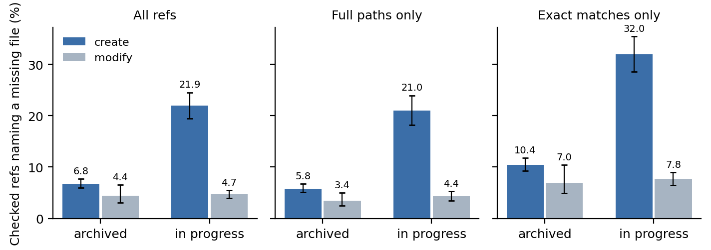
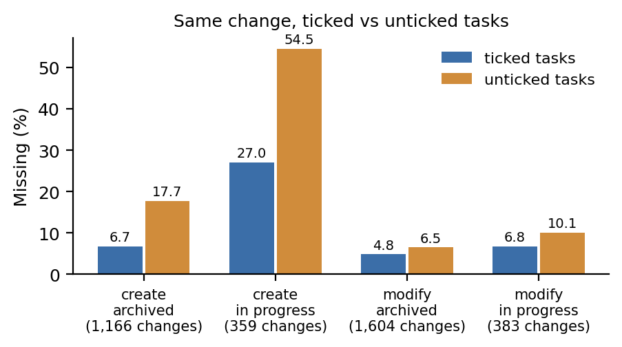

# RQ1: How often do checked OpenSpec tasks name code files that do not exist?

Rebuild everything on this page with `python run.py rq1` (about 40 seconds on the full SpecMine v1.0 data).
Numbers come from `tables/table1_rq1.csv`, `tables/checkbox_*.csv` and `logs/0*_*.json`.

## Data

| Step | Refs | Notes |
|---|---:|---|
| `openspec_code_refs` | 435,401 | every task-to-code reference |
| no anchor commit | −22,209 | nothing to check the file against |
| `exists_at_anchor = 2` | −130 | undocumented value |
| truncated repository listing | −1,021 | "missing" unreliable there |
| parser noise (globs, `Next.js`, `.ts`, placeholders, task numbers, URLs) | −6,673 | tagged, kept out of the analysis |
| **analyzable** | **405,368** | 6,802 repositories, 59,965 changes; reproduces Phase 1 (R7) exactly |

Stage 2 found the task line for 92.8% of analyzable refs and labeled its intent
(English + zh, ja, ko, es, pt, de, fr, ru, vi). Checked refs: modify 36.4%, create 33.5%,
other 25.3%, delete 2.6%, move 2.2%. "Other" fell from 36% (October) to 25%.

**Outcome.** `missing` = the file a task names is absent at the anchor commit.
**Headline population.** Checked (ticked) create and modify tasks in **archived** (finished) changes.
In-progress changes are reported separately, because code can land after the anchor commit.
**Noise floor.** A modify task names a file that should already exist, so its missing rate
estimates how much "missing" comes from matcher and parser error.
**Intervals.** 95% intervals from 1,000 bootstrap resamples of repositories (refs within a
repository are not independent).

## Result 1: create tasks name missing files more often than the noise floor

| Version | Status | Create | Modify (noise floor) | Excess (95% CI) |
|---|---|---:|---:|---|
| All refs | archived | **6.8%** (6.0–7.7) | 4.4% (3.1–6.6) | **+2.4 pts** (+0.8 to +3.4) |
| Full paths only | archived | 5.8% (5.1–6.7) | 3.4% (2.5–5.0) | +2.4 pts (+1.5 to +3.1) |
| Exact matches only | archived | 10.4% (9.2–11.8) | 7.0% (4.9–10.4) | +3.4 pts (+0.9 to +5.1) |
| All refs | in progress | 21.9% (19.5–24.5) | 4.7% (3.9–5.5) | +17.3 pts (+14.7 to +20.0) |

n = 90,715 archived create refs in 3,844 repositories; 102,985 archived modify refs in 3,988 repositories.

- About **1 in 15 checked create tasks** in finished changes names a file that is not there.
  Roughly 2.4 points of that sit above the noise floor.
- The excess survives both stricter measurements. Bare file names and name/suffix matching
  do not create it.
- The per-repository median is 0% for archived tasks: most repositories have no missing
  files, and the misses concentrate in a minority of repositories.
- In-progress rates are about three times higher. That fits code still being written after the anchor.

## Result 2: the checkbox carries real signal

**Within the same change.** Some changes have both ticked and unticked create tasks. Both sides
share one anchor commit and one repository, so timing and repository effects cancel.

| Intent | Status | Changes | Ticked missing | Unticked missing | Gap (95% CI) |
|---|---|---:|---:|---:|---|
| create | archived | 1,166 | **6.7%** | **17.7%** | +11.0 pts (+7.5 to +15.1) |
| create | in progress | 359 | 27.0% | 54.5% | +27.5 pts (+19.1 to +35.5) |
| modify | archived | 1,604 | 4.8% | 6.5% | +1.7 pts (−0.4 to +4.2) |
| modify | in progress | 383 | 6.8% | 10.1% | +3.3 pts (+0.3 to +6.4) |

Unticked create tasks are missing their file about **2.6 times as often** as ticked ones in the same change.
Modify tasks show almost no gap, which is expected, since their files exist either way.

**Over- and under-claiming (archived).**
- Over-claim (ticked, file missing): 6.8% of create tasks and 4.4% of modify tasks.
- Under-claim (unticked, file present): 80.0% of create tasks and 93.5% of modify tasks.
  Unticked boxes are mostly **work done but not ticked**, not work left undone.

**Archived with no box ticked.** 4,426 archived `tasks.md` files have no box ticked (3,733 list at
least one task). Their create refs are missing 20.9% of the time and their modify refs 6.9%.
This is close to the unticked rate above, so these look like changes archived without updating the checklist.

## Comparison with the October first cut

| | October | Now |
|---|---:|---:|
| Archived create / modify | 7.0% / 4.3% | 6.8% / 4.4% |
| Excess (all refs / full paths) | 2.7 / 2.5 pts | 2.4 / 2.4 pts |
| Within-change, archived: changes | 805 | 1,166 |
| Within-change, archived: unticked / ticked | 19.3% / 8.4% | 17.7% / 6.7% |

Same direction and similar size. The within-change set is larger because more tasks now get an intent label.

## Caveats

- **Timing.** "Missing at the anchor" is not "never written". In-progress rates include code that
  landed later, which is why archived changes are the headline.
- **Noise floor is an estimate.** Modify tasks can also name genuinely wrong files, so the
  excess over modify is a conservative estimate of unwritten files.
- **Intent rules.** Keyword rules, not hand labels. 25% of checked refs stay "other" and are
  excluded from the headline (rates for every intent are in `tables/rq1_all_intents.csv`).
  Tests in `tests/test_intent_rules.py` pin 40 example lines.
- **Exact-match version.** 28,518 refs have `exists_at_anchor = 1` but no `resolved_path`
  (Phase 1 caveat N1). Their match type is unknown, so they are left out of this version only.

## Hand-off

- Stage 2 output `data/derived/refs_with_intent.parquet` (one row per ref, with `intent`, `missing`,
  `archived`, `full_path`, `exact_match`, `is_test`, `change_dir`) is the input for stage 4 and RQ2.
- Scripts: `src/01_prepare_refs.py`, `src/02_classify_intent.py`, `src/05_rq1_prevalence.py`,
  `src/07_checkbox.py`, `src/figures_rq1.py`; helpers `src/lib/rules/intent_rules.py`, `src/lib/stats.py`.
